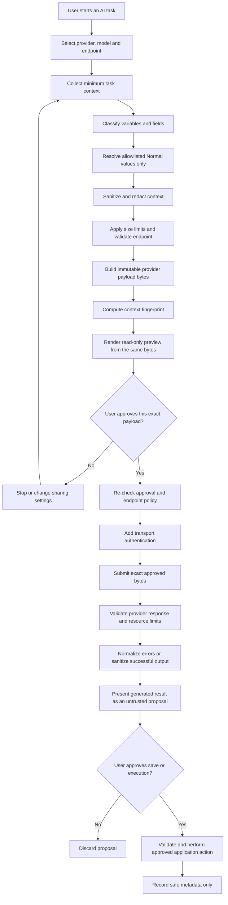
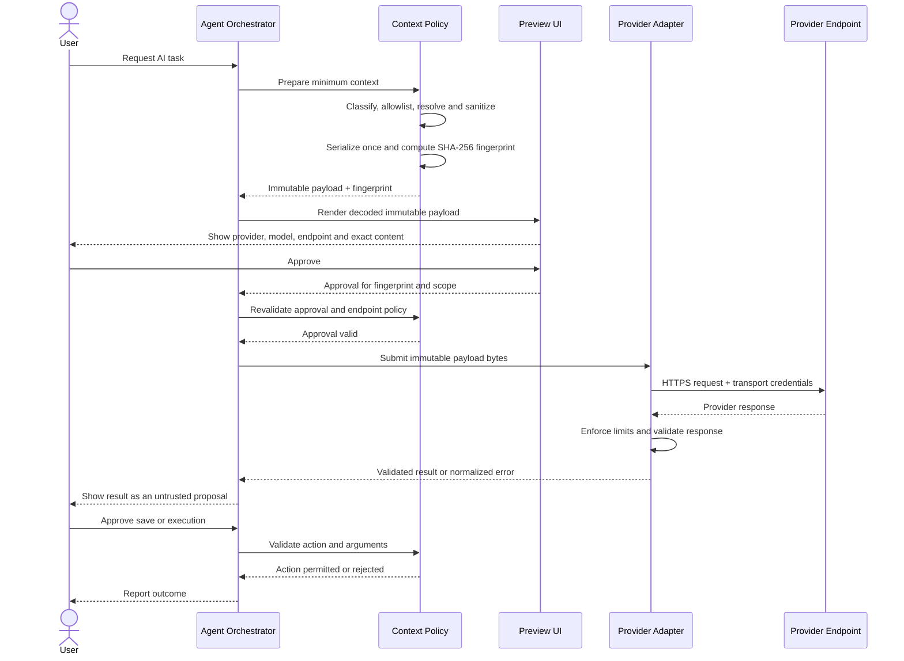

# Provider Configuration and Data-Sharing Design

**Session:** 15 (Phase 2: Model Providers and First Model Call) **Status:** Accepted, except DS-07 (provider retention verification) **Date:** 2026-11-24 **Scope:** Provider and model settings, credential handling, variable sensitivity, context
sharing, approval, preview, retention notices, and logging for the Fetch Client AI Agent. **Decision register:** `architecture-decisions.md` (DS-01 to DS-09)

---

## 1. Design Principle

Resolve enough context to make the prompt useful, but never expose sensitive values just because they were resolved.

Security is enforced at the context preparation and provider submission boundaries, not by the UI. The provider adapter receives only sanitized, policy-approved payload bytes that the user has reviewed.

Guiding rules:

- Secret, Sensitive, and Unknown values are never resolved for AI context (DS-01).
- Sensitive information is removed before it enters AI context (DS-01).
- All providers follow the same security rules (DS-03).
- Users see exactly what will be shared before it is shared (DS-04).
- Approval is bound to the exact payload bytes submitted (DS-09).
- Sensitive information never enters logs, telemetry, crash reports, or history (DS-06).
- Provider retention and training claims are recorded with a source and verification date (DS-07).

## 2. Provider and Model Settings

Each provider is configured with:

- `providerId`: unique provider identifier
- `modelId`: selected model identifier
- `endpoint`: provider base URL
- `timeoutMs`: request timeout
- `maxTokens`: maximum output tokens
- `classification`: `local` or `remote`, derived from the resolved endpoint (DS-08)
- `enabled`: whether the provider can be selected

Provider settings are stored separately from credentials.

Settings are explicit. There is no silent fallback to another provider or model.

Changing the provider, model, endpoint, or masking policy version invalidates existing approvals (DS-05, DS-09).

Adapters live under `adapters/llm/` (for example `ollama/`, `openai/`, `gemini/`, `anthropic/`, `custom/`). The core agent depends only on the `ILLMProvider` port and never on a provider SDK or implementation (platform D02, D03).

## 3. Credential Handling

Provider credentials are stored separately from application configuration.

**VS Code extension**

- Store API keys in VS Code `SecretStorage`.
- Never store keys in LokiJS, collection files, or exports.
- Never include keys in prompts, logs, error messages, or history.

**CLI**

- Initially read credentials from environment variables.
- OS-backed secure storage is a future enhancement.
- Never save credentials in the shared LokiJS database.
- Never print credential values in CLI output.

**Common rules**

- Provider keys are never sent to the LLM as prompt content.
- Authentication headers are added only at the transport layer, after the fingerprint is computed.
- Credentials are never embedded in endpoint URLs.
- A missing or rejected key produces a normalized error (Section 10) with no key text.
- Raw authentication errors are never shown to the user.

The provider key and the user's API credentials being tested in Fetch Client are separate concerns. Neither is exposed to the LLM.

## 4. Variable Sensitivity and Resolution (DS-01)

Each variable has one of four classifications:

| Classification | AI context behavior                                    |
| -------------- | ------------------------------------------------------ |
| Secret         | Never resolved. Represented by a placeholder.          |
| Sensitive      | Never resolved. Represented by a redacted placeholder. |
| Normal         | Resolved only if the sharing policy permits.           |
| Unknown        | Treated as Sensitive. Never resolved.                  |

Example.

Original request:

```json
{
  "username": "{{username}}",
  "password": "{{user_password}}",
  "accessToken": "{{access_token}}"
}
```

Classifications: `username` is Normal, `user_password` is Sensitive, `access_token` is Secret.

AI context:

```json
{
  "username": "john",
  "password": "[REDACTED]",
  "accessToken": "[REDACTED]"
}
```

### Two-stage protection

**Stage 1: Pre-resolution classification**

- Identify variable references in the request before resolution.
- Classify each referenced variable.
- Pass the resolver an allowlist of Normal variables that the policy permits. Do not resolve everything and filter afterward.

**Stage 2: Post-resolution sanitization**

- Scan the resolved context for secret-like patterns: JWTs, AWS access keys, API key formats, long hex and base64 strings, and credentials in URLs or free text.
- Pattern detection is a backup. It never replaces classification.
- If a sensitive value is found after resolution, remove it before the context is approved or submitted.

## 5. Context-Sharing Defaults (DS-03)

These defaults apply to all providers, local and remote alike.

| Data category                                              | Default           | Notes                                                          |
| ---------------------------------------------------------- | ----------------- | -------------------------------------------------------------- |
| Collection and folder names                                | Allowed           | Needed for workspace context.                                  |
| Request method and path                                    | Allowed           | Sensitive query parameters are detected and removed.           |
| Hostnames and base URLs                                    | Masked            | Replaced with `{{baseUrl}}`.                                   |
| General request headers                                    | Allowed           | For example, `Content-Type` and `Accept`.                      |
| Authentication headers                                     | Blocked           | `Authorization`, `X-API-Key`, `Cookie`, `Proxy-Authorization`. |
| Request body                                               | Requires approval | Shown in the preview after sanitization.                       |
| Response body (sample)                                     | Requires approval | Truncated and sanitized before sharing.                        |
| `Set-Cookie` response header                               | Blocked           |                                                                |
| Other response headers                                     | Masked            | Values of token-bearing headers replaced with `[REDACTED]`.    |
| Environment variable names                                 | Allowed           | Names matching sensitive patterns are excluded.                |
| Environment variable values, Normal                        | Masked by default | Shared only if the policy permits and the user approves.       |
| Environment variable values, Secret, Sensitive, or Unknown | Blocked           | Never resolved or sent.                                        |
| OpenAPI specification                                      | Requires approval | Preview lists the included paths and sanitized content.        |
| Stored response history                                    | Blocked           | Not included by default.                                       |

Additional rules:

- Unknown fields and variables are treated as Sensitive.
- Mandatory secret and credential protections cannot be disabled.
- User-configured masking rules can add restrictions but cannot remove mandatory ones.
- User approval cannot override mandatory restrictions.
- Share the minimum data needed for the task.

## 6. Endpoint Classification (DS-08)

Classification is based on the resolved endpoint, not the provider name.

A provider is `local` only when its resolved destination is a loopback address:

- Hostname `localhost`, if it resolves to a loopback address
- IPv4 in `127.0.0.0/8`
- IPv6 `::1`
- IPv4-mapped IPv6 in `::ffff:127.0.0.0/104`

Everything else is `remote`.

| Endpoint                    | Classification |
| --------------------------- | -------------- |
| `http://localhost:11434`    | Local          |
| `http://127.0.0.1:11434`    | Local          |
| `http://[::1]:11434`        | Local          |
| `http://192.168.1.10:11434` | Remote         |
| `https://api.example.com`   | Remote         |
| Remote Ollama server        | Remote         |
| Custom remote endpoint      | Remote         |

Requirements:

- Parse endpoints with a standard URL parser. Do not use substring matching.
- Compare hostnames exactly.
- Check the resolved IP address, not only the hostname text.
- Re-check classification after redirects and proxy changes. A redirect that leaves loopback makes the destination remote.
- Remote endpoints must use `https`. Plain `http` is allowed only for loopback.

A loopback endpoint does not guarantee privacy. Local proxies, other software, or logging can still retain submitted data.

## 7. Approval (DS-02, DS-05, DS-09)

Approval is required before any context is sent to a provider.

### Scopes

| Scope              | Behavior                                                              |
| ------------------ | --------------------------------------------------------------------- |
| Per-call           | Each AI request needs its own approval.                               |
| Per-task (default) | One approval covers the declared context of one AI task.              |
| Per-session        | Explicit opt-in. Reuses approval across tasks in the current session. |

### Rules for all scopes

- The approval UI shows the sanitized content, the provider, and the model.
- Approval applies only to the displayed payload and selected provider.
- Expanding context or adding newly retrieved data requires fresh approval.
- Approval never authorizes unrelated tool calls.
- Mandatory masking and secret protection cannot be overridden.

### Per-session requirements (DS-05)

- Off by default. Enabled only by explicit user action.
- A visible indicator is shown while it is active, including provider and model.
- Ends when the session ends.
- Invalidated by a change to provider, model, endpoint, masking policy version, or revocation.
- Newly expanded context requires fresh approval.

### Context fingerprint (DS-09)

```ts
interface ContextApproval {
  taskId: string;
  providerId: string;
  modelId: string;
  endpoint: string; // normalized endpoint URL, no credentials
  classification: "local" | "remote";
  policyVersion: string;
  contextHash: string; // SHA-256 over the envelope below
  approvedAt: string; // ISO 8601 UTC
  scope: "call" | "task" | "session";
}
```

The envelope hashed to produce `contextHash` contains:

- `providerId`
- `modelId`
- `endpoint` (normalized)
- `classification`
- `policyVersion`
- The exact serialized payload bytes

Fields are length-prefixed so that different combinations cannot produce the same byte sequence.

Steps:

1. Build the final sanitized provider request.
2. Serialize it once. Keep the resulting bytes immutable.
3. Compute the fingerprint from those bytes and the envelope fields.
4. Generate the preview by decoding those same bytes.
5. After approval, submit those exact bytes.
6. Never re-serialize the payload after approval.

Authentication headers are added at the transport layer after this point. They are never part of the fingerprint or the preview.

If any envelope field or the payload changes, the approval is invalid.

## 8. AI Context Preview (DS-04)

The AI Context Preview appears in the AI Agent task flow immediately before provider submission.

### Requirements

- Read-only. The user cannot edit the request through the preview.
- The user can change sharing settings and regenerate the preview.
- Shows the provider, model, and endpoint classification.
- Masked fields are visibly highlighted.
- Shows which request, response, or specification content will be shared.
- Built by decoding the same immutable bytes that will be submitted (Section 7).

### Component reuse

- Reuse the existing JSON viewer for bodies.
- Reuse the existing headers viewer.
- Reuse existing tabs and panel layout.
- Add a read-only mode. Do not reuse an editable request editor without enforcing read-only behavior.

Do not create a separate editor or a second JSON rendering system.

## 9. Provider Privacy Notices and Retention (DS-07)

Provider privacy metadata is separate from the security policy.

```ts
interface ProviderPrivacyInfo {
  providerId: string;
  providerType: "ollama" | "openai" | "gemini" | "anthropic" | "custom";
  endpointClassification: "local" | "remote";
  dataProcessingNotice: string;
  privacyPolicyUrl?: string;
  retentionNotice?: string;
  requiresNetwork: boolean;
}
```

Each provider has a verification record:

```ts
interface ProviderRetentionRecord {
  providerId: string;
  sourceUrl: string; // official documentation or contract terms
  lastVerifiedAt: string; // ISO 8601 UTC
  verifiedBy: string;
  retentionDescription: string;
  trainingUsageDescription: string;
  status: "verified" | "outdated" | "unverified";
}
```

Requirements:

- Use official provider documentation or contract terms.
- Record the source URL, date, and verifier.
- Keep retention and training sources separate when they differ.
- Re-verify when provider terms change.
- Never present unverified or outdated information as confirmed.

Retention and training behavior can depend on product, account type, contract, and account settings. Record which configuration the facts apply to.

### User-facing notices

Remote endpoint:

> Your sanitized API context will be sent to the configured endpoint. Review its data retention and privacy policy.

Local endpoint:

> Your sanitized API context will be sent to the configured local endpoint. Confirm the address points to a trusted machine.

Fetch Client does not guarantee that a local endpoint retains nothing.

## 10. Logging, Telemetry, Errors, and History (DS-06)

Sensitive information must not enter observability systems. These rules apply from the first implementation step, not only at the end.

### Never recorded

- Provider credentials
- Raw request payloads
- Raw response payloads
- Sanitized AI context
- Raw provider responses
- Raw exception messages, including after redaction
- Sensitive headers and variable values
- Full URLs containing credentials or sensitive query parameters

Raw request and response objects must not be attached to logged errors. HTTP instrumentation must not capture bodies.

### Allowed to record

- Provider ID and model ID
- Execution duration
- Normalized error kind
- Retryability
- Token counts, when available

### Normalized errors

Errors reuse the `LLMProviderError` kinds already implemented in Session 14, so there is one error contract:

`timeout`, `aborted`, `network`, `rate_limit`, `server`, `model_not_found`, `api`, `invalid_response`, `invalid_request`, `unknown`

```ts
interface SanitizedAIError {
  kind: LLMProviderErrorKind;
  retryable: boolean;
  code?: string; // optional stable code, for example "AI_PROVIDER_AUTH_FAILED"
}
```

The UI shows only the normalized error. Raw exception text is never logged or shown.

### History

- Provider responses are not saved to collection history automatically.
- Existing history mechanisms must not persist AI context or raw provider responses.
- Crash reporting must not capture application context that contains payloads.

### Inbound responses

Provider responses are untrusted. They are validated and treated as proposals under the Security Manager rules in `architecture-decisions.md`.

## 11. Implementation Order

Logging and telemetry restrictions apply to every step. A debug log added during step 3 must not capture a payload.

| Step | Activity                       | Result                                                  |
| ---- | ------------------------------ | ------------------------------------------------------- |
| 1    | Sensitive data classification  | Reliable variable and field classification              |
| 2    | Variable resolution protection | Secret, Sensitive, and Unknown variables never resolved |
| 3    | Context sanitization           | Safe AI context                                         |
| 4    | Endpoint classification        | Local and remote determined from resolved endpoint      |
| 5    | Provider privacy metadata      | Provider notices available                              |
| 6    | Read-only preview              | Preview generated from immutable payload bytes          |
| 7    | Approval and fingerprinting    | Approval bound to envelope and payload                  |
| 8    | Provider submission            | Exact approved bytes sent                               |
| 9    | Retention verification         | Verified records for each provider                      |

## 12. Acceptance Criteria

The design is ready for implementation when:

- Provider and model settings are defined.
- Credential storage is separate from configuration, with VS Code and CLI strategies documented.
- Secret, Sensitive, and Unknown variables are never resolved for AI context.
- Pattern masking is documented as secondary protection.
- Sharing defaults are identical across providers.
- Local and remote classification uses resolved destinations, and remote endpoints require HTTPS.
- Approval scopes and invalidation rules are defined, and per-session is explicit opt-in.
- The fingerprint covers provider, model, endpoint, classification, policy version, and exact payload bytes.
- Preview and submission use the same immutable bytes.
- Logging, telemetry, errors, crash reporting, and history restrictions are documented and apply from step 1.
- Retention records include source URL, date, verifier, and status.

**Acceptance dependency:** Provider retention and training information must be verified against current official documentation before the corresponding notice is marked verified or the design is fully accepted for release (DS-07).

## 13. Open Items

- **Retention facts for each provider** (DS-07): not yet recorded.
- **Carried from Session 14:** tool-call ID ownership (provider or orchestrator), and the Session 11 pricing table and benchmark runs in `docs/model-provider-comparison.md`.

## 14. Reflection (complete in session)

- Which decision was hardest to agree on, and why?
- What would change if a provider's retention terms were weaker than the default assumes?
- Where could the preview and the submitted bytes still diverge in the code?
- Did any logging path still capture a payload when you tested it?

---

## 15. Additional Security and Reliability Controls

The following controls complement DS-01 to DS-09. They are design recommendations to close implementation gaps. Map them to code and tests before marking them implemented.

### 15.1 Endpoint and Network Safety

Endpoint classification must also defend against a configured provider URL being used to reach an unintended internal or external service.

- Allow only supported URL schemes. Remote endpoints must use HTTPS; loopback HTTP remains the documented exception.
- Reject URLs containing embedded usernames or passwords, fragments, or unexpected URL components.
- Validate the destination after DNS resolution and immediately before connecting. Do not rely only on the hostname string.
- Protect against DNS rebinding and time-of-check/time-of-use changes. The address validated by policy must be the address actually used for the connection, where the runtime permits this guarantee.
- Re-validate every redirect destination. Prefer disabling redirects for provider API calls unless a provider requires them. If redirects are supported, apply the same scheme and destination policy at every hop.
- Treat proxy configuration as part of the effective network destination. Document whether environment or system proxies are honored. Do not classify a request as local merely because its configured URL is loopback when a proxy can route it
  elsewhere.
- Set explicit connection and response-size limits. Do not allow an endpoint to return an unbounded response.
- Do not automatically forward provider credentials to a redirected host.

**Implementation note:** The existing loopback classification rule is a useful baseline, but DNS, redirects, and proxy behavior must be covered by tests. A remote or private-network address remains `remote`. It is not equivalent to a trusted local
inference process.

### 15.2 Payload Construction and Data Minimization

- Build an explicit allowlisted context envelope for each task. Avoid serializing whole Fetch Client request, response, collection, environment, or workspace objects.
- Include only fields required by the selected task. For example, test generation may need method, path, approved parameters, and a sanitized response sample. It normally does not need unrelated collection history.
- Apply deterministic limits to prompt size, response sample size, OpenAPI document size, number of paths, and number of examples.
- Make truncation visible in the preview. Never silently cut content in a way that could change its meaning.
- Treat OpenAPI descriptions, examples, external `$ref` content, server URLs, and imported documents as untrusted input. Do not fetch external references automatically without a separate network policy and user-visible disclosure.
- Re-run classification and sanitization after every context expansion, transformation, or tool result, not only on the original request.
- Keep the sanitizer version and the effective sharing-policy version in the approval envelope. A sanitizer or policy change must invalidate prior approval.

### 15.3 Prompt Injection and Untrusted Content

Request bodies, response bodies, OpenAPI descriptions, examples, and provider output can contain instructions that are unrelated to the user's task.

- Treat all imported API content and provider output as data, never as trusted instructions.
- Clearly delimit untrusted source material in the prompt and tell the model not to follow instructions found inside it.
- Prompt wording is defense-in-depth only. It is not a security boundary.
- Do not let text from an API response change tool permissions, approval state, provider settings, or the user's requested task.
- Validate generated requests, tests, documentation, and tool arguments against schemas and policy rules before presenting or executing them.
- Generated content must remain a proposal. It must not be saved to the Fetch Client database or executed against an API until the user explicitly approves the relevant action.
- Never allow model output alone to authorize network access, file access, secret resolution, or database mutation.

### 15.4 Tool and Side-Effect Boundary

When the agent gains tools, apply a separate authorization boundary between model suggestions and application actions.

- The model may propose a tool call. The orchestrator validates the tool name, schema, arguments, task scope, and permissions.
- Read-only tools and side-effecting tools must be distinguishable.
- Saving to LokiJS, modifying collections, sending API requests, and accessing files are side effects and require explicit user approval.
- Tool arguments must pass the same sensitive-data checks as provider context.
- Tool results are untrusted input and must be sanitized before they are added to a later model context.
- Enforce per-task tool-call limits, maximum iterations, execution timeouts, and cancellation.
- Record safe execution metadata (tool identifier, outcome category, duration) without recording sensitive arguments or results.

### 15.5 Provider Response and Resource Limits

- Validate the HTTP status, content type, response structure, required fields, and expected data types before accepting a provider response.
- Enforce maximum response bytes and maximum generated output size before parsing or displaying content.
- Treat malformed, incomplete, or unexpected provider output as a normalized error. Do not attempt unsafe automatic repair.
- Respect cancellation while connecting, reading the response body, parsing, and processing the result.
- Apply bounded retries only to retryable failures. Use backoff and jitter for rate limits and transient server or network failures.
- Do not retry non-idempotent operations blindly. Provider generation calls should have a documented retry policy, because a retry can incur additional usage or produce a different result.
- Keep timeout, cancellation, and response-size failures distinct in tests and normalized error handling.

### 15.6 Privacy Notice Lifecycle and User Choice

- Show the privacy notice when a provider is first configured, and whenever its endpoint classification or recorded privacy metadata changes.
- Identify the exact provider, model, endpoint, endpoint classification, and account or product tier where known.
- For custom endpoints, display that Fetch Client cannot independently verify the operator's retention or training practices.
- Store only the minimum acknowledgement metadata needed, such as notice version and acknowledgement time. Do not store the prompt or payload as proof of consent.
- Provide a way to review the notice again and disable a provider.
- A privacy notice is disclosure, not a guarantee or a substitute for sanitization and approval.
- Distinguish provider-side retention from Fetch Client local storage and history. Document the local lifecycle for previews, temporary buffers, caches, and crash artifacts as well.

### 15.7 Testing and Release Gates

Add automated tests for at least these cases:

- Secret, Sensitive, and Unknown variables are not resolved, including nested and missing references.
- Secret-like values in free text, URLs, headers, and response samples are redacted.
- Sanitization is re-applied after context expansion and tool results.
- Preview bytes, fingerprinted bytes, and submitted bytes are identical.
- Any change to provider, model, endpoint, policy or sanitizer version, or payload invalidates approval.
- Redirects, DNS changes, proxies, IPv4 and IPv6 loopback forms, and non-loopback destinations are classified safely.
- Provider credentials are not forwarded across redirects and never appear in logs or errors.
- Oversized and malformed provider responses are rejected safely.
- Cancellation and timeout work during response-body reading and parsing.
- Prompt-injection text in API descriptions or responses cannot trigger tools or bypass approval.
- Generated content cannot save or execute without the required user approval.
- Logs, telemetry, crash reports, and history contain no payloads, secrets, or raw exception messages.

**Release gate:** Do not enable a provider for general use until its endpoint policy, context sanitization, approval binding, error handling, and privacy notice have passing tests. Do not mark DS-07 verified until the provider-specific evidence has
been recorded.

## 16. End-to-End Data-Sharing Flow

The flow below shows the intended boundary from task selection through provider submission and result handling. The preview and submission must use the same immutable serialized payload.



### 16.1 Approval and Submission Sequence



## 17. Updated Open Items and Decisions

Keep these items open until evidence or implementation exists:

- **DS-07, provider retention verification:** record official retention, training-use, abuse-monitoring, deletion, data-residency, and account-tier details for each supported provider. Use `Unknown` where evidence is unavailable.
- **Endpoint safety:** verify DNS resolution, redirects, proxy behavior, and destination pinning against the runtime implementation.
- **Payload limits:** choose and document concrete maximum sizes for context, OpenAPI input, response samples, and provider output.
- **Prompt-injection boundary:** define the trusted instruction hierarchy and test that untrusted API content cannot authorize tools or side effects.
- **Tool authorization:** define the approval policy for database writes, API execution, file access, and other side effects before enabling those tools.
- **Local data lifecycle:** document whether temporary previews, buffers, caches, and crash artifacts can persist, and how they are cleared.
- **Carried from Session 14:** tool-call ID ownership (provider or orchestrator), and the Session 11 pricing table and benchmark runs in `docs/model-provider-comparison.md`.

### Suggested implementation order for the new items

1. Add endpoint, redirect, and proxy tests before enabling custom endpoints.
2. Add payload-size limits and explicit context allowlists.
3. Add prompt-injection and tool-side-effect authorization tests before enabling tools.
4. Add response-size and retry policies to provider adapters.
5. Complete provider-specific DS-07 research and privacy notices.
6. Document the local temporary-data lifecycle and verify observability redaction.

**Status note:** These additions are design recommendations, not proof that the controls are already implemented. Keep them marked as pending until code, tests, and provider evidence support the claims.
