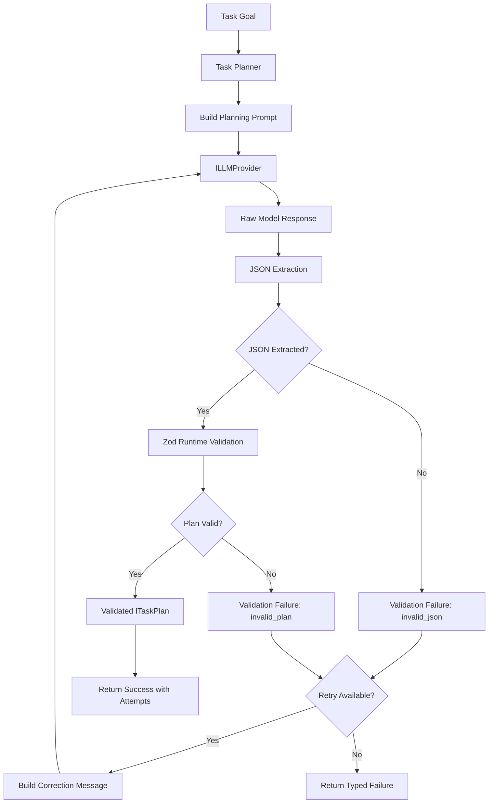

# Session 16: Structured Output (Phase 2, Day 16)

**Status:** Completed  
**Date:** 2026-11-26  
**Goal:** Request a task plan as JSON and validate it at runtime.  
**Deliverable:** Validated task-plan response.

## Objective

Implement a provider-independent task planner that requests a structured task plan from an LLM, extracts the JSON response, validates it at runtime, and returns a typed result.

The planner must not execute planned steps. It only generates and validates the plan. Tool execution, policy enforcement and approval remain separate responsibilities.

## Architecture

### Responsibility boundaries

| Component | Responsibility |
|---|---|
| Task Planner | Build prompts, request plans, coordinate validation and retry |
| ILLMProvider | Communicate with the selected model provider |
| JSON extraction | Extract a JSON object from model output |
| Zod schema | Validate the runtime structure and constraints |
| Retry mechanism | Send validation feedback and request a corrected response |
| Orchestrator | Handle provider errors and downstream orchestration |
| Policy and approval layer | Determine whether planned actions are permitted |
| Tool executor | Execute permitted tools independently of planning |

## Files

| File | Purpose |
|---|---|
| `src/fetch-client-ai-agent/types/task-plan.ts` | Defines `ITaskPlan` and `ITaskStep` |
| `src/fetch-client-ai-agent/services/task-plan.schema.ts` | Defines `PLANNED_TOOL_NAMES`, `ToolNameSchema` and `TaskPlanSchema` using Zod |
| `src/fetch-client-ai-agent/services/task-planner.ts` | Prompt builder, JSON extraction, validation, retry and planning result |
| `src/test/ai-agent/services/task-planner.test.ts` | Planner validation, extraction, retry and failure tests |

## Implementation

### Task plan contract

The task plan contains a goal and ordered steps.

Each step contains:

- `id`: sequential positive integer.
- `description`: actionable description.
- `riskLevel`: `read`, `write` or `destructive`.
- `toolName`: optional tool identifier from the allowed tool list.

### Runtime validation

The planner validates the model response at runtime using Zod.

Validation includes:

- Required top-level properties.
- Non-empty goal.
- At least one step.
- Positive sequential step IDs.
- Non-empty step descriptions.
- Valid risk levels.
- Valid tool names from the allowlist.
- No duplicate step IDs.
- No unexpected properties at the plan or step level.

### JSON extraction

The JSON extraction helper supports:

- Plain JSON responses.
- JSON wrapped in code fences.
- JSON surrounded by prose, where extraction succeeds.

The extracted value is treated as `unknown` until it passes runtime schema validation.

### Retry behavior

- `maxRetries` defaults to `1`.
- One initial attempt and one retry are permitted by default.
- JSON extraction failures and schema validation failures produce correction feedback.
- The previous response and correction message are appended to the conversation before retrying.
- Validation failures are returned as typed data after the retry cap is reached.
- Provider errors are not caught by the planner and propagate to the existing error-handling layer.

### Result contract

The planner returns a discriminated union:

- **Success:** Validated `ITaskPlan` and attempt count.
- **Failure:** Typed validation failure and attempt count.

Validation failure categories:

- `invalid_json`
- `invalid_plan`, including validation issue descriptions.

Raw model output and parsed values are not included in validation failure details.

## Design decisions

- **Validation library:** Zod, to match the Session 8 request validators. Ajv remains in `tool-executor.ts` for tool input schemas. The two are kept separate on purpose.
- **Tool allowlist:** `toolName` is validated against `PLANNED_TOOL_NAMES`, the same list used to build the prompt. This checks the identifier only. Execution still requires the policy check and approval gate.
- **Sequential step IDs:** Required to be `1, 2, 3...`. Duplicates and non-sequential IDs are rejected.
- **Strict schema:** Unexpected properties are rejected rather than silently accepted.
- **Retry cap:** `maxRetries` defaults to 1, so at most two model calls per plan. Validation errors are sent back to the model.
- **Provider errors:** Not caught by the planner. They propagate to the existing error-mapping layer.
- **Goal encoding:** The goal is encoded as a JSON string within the prompt rather than inserted as raw XML-style content. This is a prompt-level control, not a security boundary.
- **Type assertion:** No `as ITaskPlan` assertion is used. The validated result is returned without a type assertion.
- **Cancellation:** `AbortSignal` is forwarded to the provider.
- **Prompt version:** `TASK_PLAN_PROMPT_VERSION` is defined as `task-plan-v1` for identification and future traceability.
- **Planning boundary:** The planner generates and validates plans but does not execute tools.

## Test results

| ID | Test case | Expected result | Status |
|---|---|---|---|
| TC-01 | Valid plan | `ok: true` | Pass |
| TC-02 | Fenced JSON | `ok: true` after extraction | Pass |
| TC-03 | Prose before and after JSON | `ok: true` after extraction | Pass |
| TC-04 | Step missing `riskLevel` | `invalid_plan` | Pass |
| TC-05 | Unknown `toolName` (`deleteEverything`) | `invalid_plan` | Pass |
| TC-06 | Duplicate step ID | `invalid_plan` | Pass |
| TC-07 | IDs `1, 5, 9` | `invalid_plan` | Pass |
| TC-08 | Empty `steps` array | `invalid_plan` | Pass |
| TC-09 | Extra property (`notes`) | `invalid_plan` | Pass |
| TC-10 | Retry succeeds after invalid first reply | `ok: true`, `attempts: 2` | Pass |
| TC-11 | Retry cap reached | `ok: false`, `attempts: 2` | Pass |
| TC-12 | Goal containing `</goal>` and instructions | Treated as data, plan still validated | Pass |

**Test run:** All listed test cases passed.

**Test command:** [Record the exact command used, e.g. `pnpm vitest run src/test/ai-agent/services/task-planner.test.ts`]

**Full suite / type check / lint:** [Record actual verification results.]

## Reflection

- **Structured output:** The LLM response is no longer trusted as arbitrary text. It is converted into a validated task-plan contract.
- **JSON extraction:** Extraction allows the planner to handle common model response variations, such as code fences and surrounding prose, while validation remains mandatory.
- **Runtime validation:** The schema enforces structural, semantic and allowlist constraints that cannot be reliably enforced by prompting alone.
- **Retry behavior:** The planner can recover from an invalid response by providing validation feedback and requesting a corrected response.
- **Tool allowlist:** Unknown tool identifiers are rejected at the schema boundary.
- **Risk classification:** Each step carries a risk classification, but the classification itself is model-generated data and must not replace independent policy enforcement.
- **Security boundary:** Prompt instructions and runtime plan validation do not authorize execution. Policy checks, approvals and tool-level validation remain necessary.
- **Provider independence:** The planner continues to use `ILLMProvider` without being coupled to Ollama-specific implementation details.

### Model behavior observations

- Most common model error: [Record actual observation.]
- Did retry help?: [Record observed result.]
- Did JSON-string goal encoding change behavior?: [Record observed result.]
- Which prompt rules were broken without schema enforcement?: [Record actual observation.]
- Would schema-constrained model output help?: Not yet evaluated / [Record result if tested.]

## Accepted gaps

- The returned `goal` is not checked against the requested goal. Deliberate for Day 16. Revisit once we decide whether the model may normalize it.
- No goal length limit yet. Needs a product decision.
- Prompt rules are not a security boundary.
- The planner validates tool identifiers but does not authorize tool execution.
- JSON extraction is pragmatic and may not handle every possible malformed or ambiguous response.
- Retry behavior is bounded but does not guarantee a valid response.
- Schema-constrained output using Ollama's `format` option has not yet been evaluated.

## Carry-over from earlier sessions

- **Session 14:** Tool-call ID ownership decision (provider vs orchestrator).

## Learning outcomes

- Understand structured output in LLM applications.
- Distinguish prompt instructions from runtime enforcement.
- Understand JSON parsing versus runtime schema validation.
- Use Zod to validate model-generated data.
- Implement a bounded retry mechanism for invalid model output.
- Use discriminated unions to represent expected planner outcomes.
- Maintain provider-independent planning logic.
- Keep planning, policy enforcement, approval and execution separate.

## Next

**Day 17:** Confirm the next task directly from the AI Agent learning tracker before beginning.
