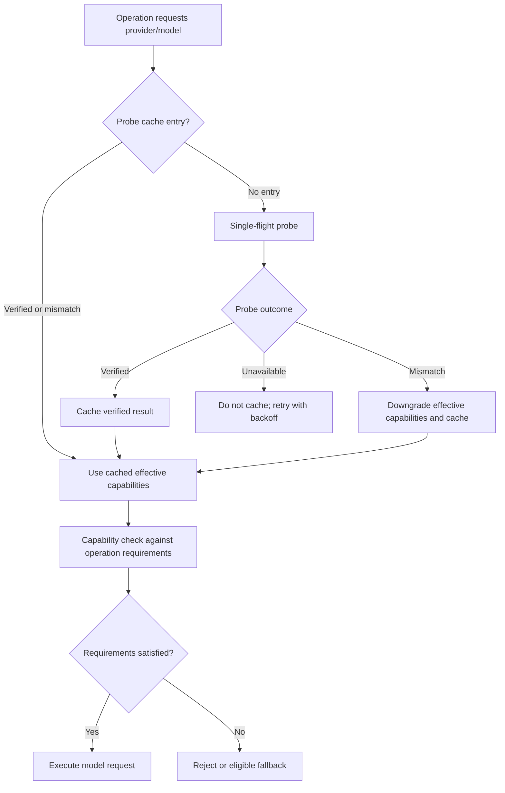

# Session 17: ProviderCapabilities design

Phase 2, Day 17. Goal: define capability metadata, required and optional capabilities, unsupported capabilities, and fallback behaviour.

## 1. Principles

- Capabilities are declared per `(providerId, modelId)`, never per provider alone.
- Capabilities describe what a model can do. They are not trusted output. LLM output stays untrusted and is validated elsewhere.
- Each operation declares its requirements. The check runs before the first request.
- Every fallback is a recorded decision (`Degradation`) and is visible in the run result.
- Locality (local or remote, D-08) is not a capability. It is derived from the resolved endpoint and governs data sharing and approval.
- Tool-call ID handling and probe lifecycle are protocol and runtime concerns, not capability evaluation. They are decided separately (sections 7 and 8).

## 2. Capability metadata

| Field                | Type                                     | Meaning                                                                                  |
| -------------------- | ---------------------------------------- | ---------------------------------------------------------------------------------------- |
| `toolCalling`        | `'native' \| 'none'`                     | Provider returns structured tool calls                                                   |
| `parallelToolCalls`  | boolean                                  | Several tool calls in one turn                                                           |
| `structuredOutput`   | `'json_schema' \| 'json_mode' \| 'none'` | Strength of output constraint                                                            |
| `streaming`          | boolean                                  | Incremental output                                                                       |
| `honoursAbortSignal` | boolean                                  | Cancels the request on `AbortSignal`                                                     |
| `maxContextTokens`   | number                                   | Input context limit. Recorded for a future context-management consumer; not checked here |

## 3. Requirements per operation

- Agent loop: `toolCalling: 'native'`, `honoursAbortSignal: true`. No fallback.
- Task plan (Session 16): `structuredOutput: 'json_mode'`. Fallback allowed, because the plan is already validated at runtime.

## 3a. Check result

`checkCapabilities` returns `{ ok, degradations }` on success and `{ ok: false, missing, degradations }` on failure. Degradations are kept on failure so diagnostics are not lost. For example, a run can fail on missing tool calling while also
recording that structured output would have been degraded. The run result records these decisions consistently.

## 4. Unsupported capabilities and fallback

| Gap                          | Allowed response                                                                            | Not allowed                                                |
| ---------------------------- | ------------------------------------------------------------------------------------------- | ---------------------------------------------------------- |
| No native tool calling       | Fail. Plan-only mode is a later option                                                      | Parsing tool calls from free text and executing them       |
| No strict structured output  | Prompt for JSON, validate with Zod, retry once, record `structured_output:prompt_validated` | Trusting raw text                                          |
| No streaming                 | Single request, record `streaming:disabled`                                                 | Faking stream events                                       |
| No abort signal support      | Fail. Cancel must work                                                                      | Ignoring cancel                                            |
| Primary provider unavailable | Switch only to a provider that meets the same requirements and the same locality rule       | Local to remote switch. Reusing an approval after a switch |

A missing required capability fails with a new `LLMProviderError` kind: `unsupported_capability`, `retryable: false`. This extends the error kinds in `types/agent-dependencies.ts`.

## 5. Approval and fallback

Any provider or model switch changes the D-09 approval fingerprint (providerId, modelId, endpoint, classification, policyVersion, payload bytes). A fallback therefore needs fresh approval.

## 6. Declared is not verified

Declared capabilities are checked by a probe (section 8). Stored probe results sit alongside the declared values. A probe mismatch downgrades the declared value, never the other way round.

## 7. OD-02: Tool-call ID ownership (decided)

Question: which component owns creation, validation and preservation of tool-call IDs across the model response, tool execution and the follow-up model request?

Decision:

- **Provider adapter** preserves the model's tool-call ID as `providerCallId` and normalizes it. It does not generate IDs for calls that have one.
- **Agent runtime** owns validation and correlation. Each tool result must reference exactly one call from the assistant message that requested it. IDs must be unique within a turn. Results with unknown or duplicate IDs are rejected, not guessed at.
- **Fallback for missing IDs.** Some local models, Ollama among them, may return no tool-call ID. The runtime generates one and records `idSource: 'runtime'` on the normalized call, so its origin is never hidden.
- **Capabilities do not own IDs.** `toolCallIdSource` is not added to `ProviderCapabilities`. Tool-call ID handling is a protocol contract, not a model capability. If providers later need different protocol formats, add a protocol-specific
  abstraction at that point.

Contract change needed in `topics/agent-contracts.md` and `types/agent-contracts.ts`: add `providerCallId?: string` and `idSource: 'provider' | 'runtime'` to `ToolCall`. The runtime's `id` remains the internal key.

## 8. OD-03: Capability probe timing (decided)

Question: when should capability verification run, at startup or on first use?

Decision: lazy first-use probing with a cache. Startup performs no network or model probes. Startup should not depend on every configured LLM being reachable, the user may configure several models but use one, and remote probes can add latency and
cost.

Behaviour:

| Concern           | Decision                                                                                                                                           |
| ----------------- | -------------------------------------------------------------------------------------------------------------------------------------------------- |
| Trigger           | First use of a configured provider/model                                                                                                           |
| Concurrency       | Single-flight. Concurrent requests for an unprobed model share one probe                                                                           |
| Outcomes          | `verified`, `mismatch`, or `unavailable`                                                                                                           |
| Caching           | Cache `verified` and `mismatch`. Never cache `unavailable`                                                                                         |
| Mismatch          | Downgrade the declared capabilities for that model. Record the mismatch                                                                            |
| Unavailable       | Retry later with backoff. Do not mark any capability as unsupported                                                                                |
| Cache key         | providerId, modelId, normalized endpoint, policyVersion (the D-09 fields)                                                                          |
| Invalidation      | Any cache key field changes, or an explicit re-probe                                                                                               |
| Runtime drift     | If a verified model later stops behaving as declared (for example, no tool calls), trigger a re-probe rather than downgrading permanently          |
| Probe input       | Fixed synthetic prompt only, never user content. No D-09 payload approval needed. Still classified by endpoint. Logs contain normalized codes only |
| Manual validation | Reserved for a future explicit provider validation action                                                                                          |

A failed probe does not show that a model lacks a capability. It may only mean the provider is down. `unavailable` must never be recorded as `mismatch`.

## 8a. Probe lifecycle diagram



**Safety boundary:** probing uses a fixed synthetic input, not user data. A provider/model switch is a new execution identity and requires fresh approval under D-09. Probe failures are operational failures (`unavailable`), not evidence of unsupported
capability.

## 8b. Tool-call ID lifecycle diagram

```mermaid
sequenceDiagram
    participant P as Provider Adapter
    participant R as Agent Runtime
    participant T as Tool Executor
    P->>R: Normalized ToolCall (providerCallId if supplied)
    R->>R: Validate and assign internal id
    Note over R: Missing provider ID: generate internal id
and record idSource=runtime
    R->>T: Execute using internal id/call context
    T->>R: Tool result correlated to internal id
    R->>R: Validate unique, known IDs and result correlation
    R->>P: Follow-up conversation with normalized result
```

The runtime's internal `id` is the correlation key. `providerCallId` is retained for provenance/protocol fidelity where supplied. The exact mapping back to provider-specific continuation format remains the responsibility of the adapter.

## 9. Carry-over

- DS-07: provider retention verification (Session 15).
- Session 15 reflection.
- Session 11 pricing table and TC-01 to TC-05 benchmarks.
- Open follow-up: `ToolCall` contract change in section 7.
- Open follow-up: `maxContextTokens` placeholder values for Ollama, pending probe.

## 10. Files

Types only, in `types/`:

- `src/fetch-client-ai-agent/types/provider-capabilities.ts`: `StructuredOutputSupport`, `ProviderCapabilities`, `CapabilityRequirements`, `CapabilityKey`, `Degradation`, `CapabilityOptions`, `CapabilityCheck`.

Logic, in `services/`, with tests in `src/test/ai-agent/services/`:

- `src/fetch-client-ai-agent/services/capability-check.ts`: `checkCapabilities`.

Adapter values, in `adapters/llm/`:

- `src/fetch-client-ai-agent/adapters/llm/ollama-capabilities.ts`: Ollama declarations. Placeholders until the probe confirms them.

Callers own their requirement constants:

- `AGENT_LOOP_REQUIREMENTS` in `core/agent-orchestrator.ts`.
- `TASK_PLAN_REQUIREMENTS` in `services/task-planner.ts`.

Session notes:

- `docs/ai-agent/sessions/session-17-provider-capabilities.md`: this note.

## 11. Tests to add

Capability check (`services/capability-check.ts`):

- Missing tool calling fails with `missing: ['toolCalling']`.
- Structured output gap with fallback allowed returns `degradations: ['structured_output:prompt_validated']`.
- Structured output gap with fallback disallowed fails.
- `json_schema` satisfies a `json_mode` requirement.
- Streaming gap with fallback allowed returns `streaming:disabled`.
- Abort signal gap fails.
- Missing tool calling with a structured output fallback allowed returns `ok: false`, `missing: ['toolCalling']`, and `degradations: ['structured_output:prompt_validated']`.

Tool-call IDs (runtime, once the contract change lands):

- Provider-supplied ID is preserved as `providerCallId` with `idSource: 'provider'`.
- Missing provider ID gets a runtime ID with `idSource: 'runtime'`.
- A tool result referencing an unknown ID is rejected.
- Duplicate IDs within a turn are rejected.

Probe (once the probe exists):

- Concurrent first requests share one probe.
- `unavailable` is not cached and is retried.
- `mismatch` is cached and downgrades the declared capabilities.
- A change to endpoint or policyVersion invalidates the cache.
- Probe logs contain no payload or raw error text.

## 12. Implementation notes and boundaries

- Capability declarations and probe results are distinct records. The probe may reduce the effective capability set; it must not promote a declaration based solely on untrusted model output.
- Capability probing is not a guarantee of future behaviour. Runtime drift should trigger a re-probe and be handled as an execution failure in the current attempt.
- Probe cache single-flight coordination and backoff belong to the probe service, not `checkCapabilities`.
- The capability evaluator remains a pure function: no network calls, cache access, provider selection, approval handling, or retries.
- Fallback provider selection is not implemented in this session. If later implemented, candidate providers must satisfy the same operation requirements and locality/data-sharing policy, and any provider/model switch requires fresh approval.
- The structured-output fallback is bounded: prompt for JSON, validate with Zod, retry once, and record the degradation. It must not be treated as equivalent to native constrained output.

## 13. Reflection and results (to complete)

Results (full suite run, 2026-11-27):

| Test file                                   | Tests              | Result       |
| ------------------------------------------- | ------------------ | ------------ |
| services/capability-check.test.ts           | 17                 | Pass         |
| core/http-client.test.ts                    | 30                 | Pass         |
| adapters/llm/ollama/ollama-provider.test.ts | 53                 | Pass         |
| services/task-plan.schema.test.ts           | 30                 | Pass         |
| services/task-planner.test.ts               | 30                 | Pass         |
| core/tool-executor.test.ts                  | 4                  | Pass         |
| core/agent-orchestrator.test.ts             | 33                 | Pass         |
| **Total**                                   | **197 in 7 files** | **All pass** |
